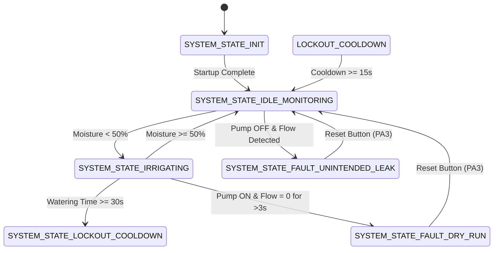

# POWERPOINT PRESENTATION SLIDE DECK
## SMART IRRIGATION & WATER-LEAK CONTROLLER
**Course**: 23CSE304 – Embedded Systems  
**Department**: Computer Science and Engineering  
**Institution**: Amrita Vishwa Vidyapeetham  

---

### SLIDE 1: Title Slide

**Project Title**: Smart Irrigation & Water-Leak Controller  
**Subtitle**: An Event-Driven, Non-Blocking Resource Optimization & Pipeline Diagnostic System  

**Team Members**:
- **K Dharani Kumar** (`AM.SC.U4CSE24123`)
- **K Bhanu Sai Raj** (`AM.SC.U4CSE24125`)
- **M Surya Kiran** (`AM.SC.U4CSE24130`)
- **Ayman Jasim M R** (`AM.SC.U4CSE24163`)

**Target Microcontroller**: STM32F103C8T6 (ARM Cortex-M3 @ 72 MHz)  
**Academic Year**: 2026  

---

### SLIDE 2: Project Working Status

#### 100% Completed in Software & Hardware Simulation
- **Embedded C Firmware**: Production-grade modular drivers built with ST HAL (`0 Errors, 0 Warnings`).
- **Target Hardware Architecture**: STM32F103C8T6 ARM Cortex-M3 operating at 72 MHz (HSE 8 MHz + PLL x9).
- **Wokwi Virtual Schematic**: Complete hardware circuit featuring STM32 Blue Pill, 10k Potentiometer, 16x2 HD44780 LCD, Flow Pulse Button, Fault Button, Status LEDs, and Buzzer.
- **Hardware-Ready**: Compiled `.elf` / `.bin` binary is 100% ready to be flashed directly onto physical Blue Pill hardware via ST-Link V2.

---

### SLIDE 3: Problem Statement

- **Agricultural Water Wastage**: Traditional irrigation relies on crude open-loop timers or continuous delay polling, leading to severe water wastage and soil over-saturation.
- **Pump Motor Destruction**: Pumping water when supply tanks are empty (dry-running) overheats and burns out motor windings.
- **Unmonitored Pipeline Leaks**: Structural pipe cracks and stuck-open solenoid valves cause undetected freshwater losses.
- **The Solution**: An autonomous, closed-loop resource management system providing dynamic, demand-based watering with real-time pipeline integrity diagnostics.

---

### SLIDE 4: Objectives & UN SDG Alignment

1. **Resource Optimization (UN SDG 12)**: Responsible Consumption & Production through demand-driven irrigation on an ARM Cortex-M3 MCU.
2. **Dynamic 12-Bit ADC Sampling**: Precision soil moisture measurement via `ADC1_IN0` ($0\dots4095 \rightarrow 0\dots100\%$).
3. **Proportional PWM Speed Regulation**: `TIM2_CH2` 1 kHz PWM motor control adjusting pump speed inversely with soil hydration.
4. **Hardware Timer Lockout Protection**: `TIM3` 100ms periodic tick enforcing a 30-second continuous watering limit & 15-second cooldown to prevent flooding.
5. **Real-Time Leak Diagnostics**: Pulse integration via `EXTI2` for dry-run and pipe burst fault detection with SPI1 diagnostic telemetry.

---

### SLIDE 5: System Architecture & Block Diagram

```
                                +-------------------+
Soil Moisture (Pot) ----------> | PA0 (ADC1_IN0)    |
Water Pump PWM      <---------- | PA1 (TIM2_CH2)    |
Flow Sensor Pulses  ----------> | PA2 (EXTI2)       |
Virtual Fault Button ---------> | PA3 (EXTI3)       |
SPI1 Bus (CS/SCK/MOSI) <------ | PA4 - PA7 (SPI1)  | ---> SPI Telemetry
                                |                   |
LCD RS / EN         <---------- | PB0 / PB1         |
Status LEDs (G/Y/R) <---------- | PB5 / PB6 / PB7   |
Alarm Buzzer        <---------- | PB8               |
LCD Data (D4-D7)    <---------- | PB12 - PB15       |
                                +-------------------+
```

---

### SLIDE 6: Pin Mapping & Peripheral Configuration

| STM32 Pin | Peripheral / Channel | Function / Connected Component |
|---|---|---|
| **PA0** | `ADC1_IN0` (12-Bit ADC) | Soil Moisture Sensor Input ($0\dots3.3\text{V}$) |
| **PA1** | `TIM2_CH2` (1 kHz PWM) | Water Pump Motor Speed Drive ($0\dots100\%$) |
| **PA2** | `EXTI2` (Rising Edge IT) | Water Flow Sensor Pulse Input (Hall Effect) |
| **PA3** | `EXTI3` (Falling Edge IT)| Virtual Fault Injector / Reset Pushbutton |
| **PA4–PA7**| `SPI1 Master` | Telemetry Bus Output (CS, SCK, MISO, MOSI) |
| **PB0, PB1**| GPIO Output | LCD Register Select (RS) & Enable (EN) |
| **PB5** | GPIO Output | **Green LED**: Normal Hydrated State ($\ge 50\%$) |
| **PB6** | GPIO Output | **Yellow LED**: Irrigating State ($< 50\%$) / Lockout |
| **PB7** | GPIO Output | **Red LED**: Emergency Leak Alarm |
| **PB8** | GPIO Output | **Audible Buzzer**: Fault Alarm Sounder |
| **PB12–PB15**| GPIO Output | LCD 4-bit Parallel Data Lines (D4–D7) |

---

### SLIDE 7: Software Engineering & Driver Architecture

- **Modular C Code Structure**:
  - `main.c`: System clock configuration (72 MHz), HAL peripheral init, and main loop.
  - `adc.c`: 12-bit ADC sampling and linear $0\dots100\%$ moisture conversion.
  - `pwm.c`: Proportional PWM duty cycle calculation & `TIM2` compare register updates.
  - `lcd.c`: 4-bit parallel GPIO driver for HD44780 16x2 LCD.
  - `spi.c`: Formats and transmits 8-byte telemetry frames with XOR checksum over `SPI1`.
  - `leak_detection.c`: Flow rate integration ($Q = \text{Pulses} / 7.5$) and fault classification.
  - `irrigation_controller.c`: Core Finite State Machine (FSM) and LED/Buzzer orchestrator.
  - `interrupt_handlers.c`: `TIM3` 100ms ISR tick & `EXTI2`/`EXTI3` callbacks.

---

### SLIDE 8: Event-Driven FSM & Timer ISR Logic



- **Non-Blocking Architecture**: `TIM3` generates 100ms interrupts. Main loop executes FSM without any blocking `HAL_Delay` calls.

---

### SLIDE 9: Pipeline Leak Diagnostics Algorithm

#### 1. Dry-Run Pump Failure (Motor Burnout Protection)
- **Condition**: Pump is **ON** ($PWM > 0\%$), but flow pulses $= 0$ for $>3\text{ seconds}$.
- **Action**: Immediate emergency pump shutdown. **Red LED ON**, **Buzzer ON**, LCD displays `ALARM: DRY RUN! PUMP NO WATER`.

#### 2. Unintended Pipe Burst / Valve Leak (Water Wastage Prevention)
- **Condition**: Pump is **OFF** ($PWM = 0\%$), but flow pulses $\ge 2\text{ pulses/sec}$.
- **Action**: Emergency alert raised. **Red LED ON**, **Buzzer ON**, LCD displays `ALARM: PIPE LEAK UNINTENDED FLOW!`.

#### 3. Alarm Reset
- Pressing Red Button (`PA3` EXTI3) clears fault state and resets system to normal monitoring.

---

### SLIDE 10: Expected Outputs & Simulation Results

#### 1. Normal Hydrated State ($\ge 50\%$ Moisture)
```text
Mst: 75% Pmp:OFF
PWM:  0% Flow:OK
```
*Green LED ON | Yellow OFF | Red OFF | Pump 0% PWM*

#### 2. Smart Irrigation Active State ($< 50\%$ Moisture)
```text
Mst: 15% Pmp:ON 
PWM: 79% Flow:OK
```
*Yellow LED ON | Green OFF | Red OFF | Pump 79% PWM*

#### 3. Dry-Run Emergency Fault Alarm
```text
ALARM: DRY RUN! 
PUMP NO WATER   
```
*Red LED ON | Buzzer ON | Pump Forced OFF (0% PWM)*

---

### SLIDE 11: Real-World Applications & Impact

- **Precision Agriculture**: Large-scale autonomous field irrigation saving up to $40\%$ freshwater.
- **Commercial Greenhouses**: Micro-climate hydration control bounded by strict hardware safety timers.
- **Municipal Urban Parks**: Automated watering of public green spaces with real-time pipe leak detection.
- **Residential Smart Gardens**: Autonomous garden watering with main line flood protection.

---

### SLIDE 12: References & Standards

1. **STMicroelectronics**, *"STM32F103xC/D/E Advanced ARM-based 32-bit MCUs Reference Manual,"* DocID13902.
2. **United Nations**, *"Sustainable Development Goal 12: Responsible Consumption and Production,"* UN Guidelines.
3. **ARM Limited**, *"Cortex-M3 Technical Reference Manual,"* Revision r2p1.
4. **Department of CSE**, *"23CSE304 – Embedded Systems Project Guidelines,"* Amrita Vishwa Vidyapeetham, 2026.
