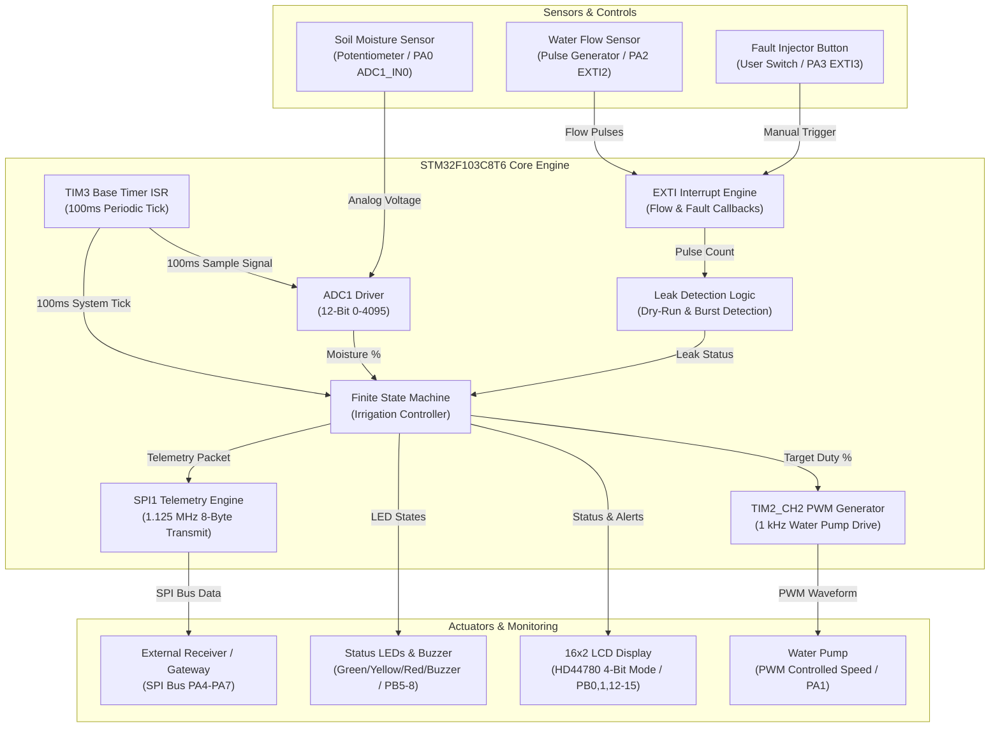
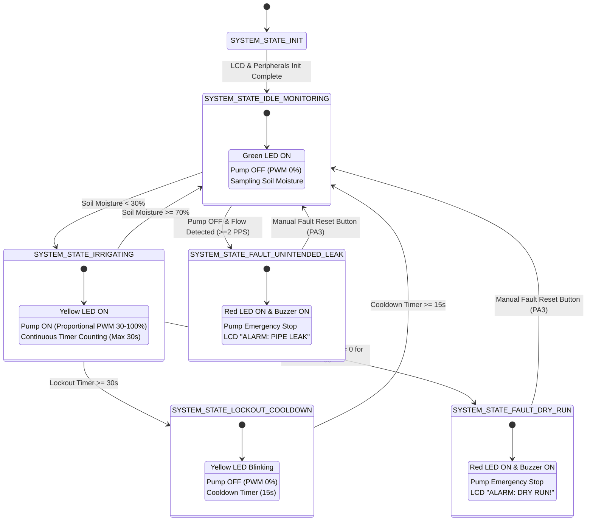

# ACADEMIC PROJECT DOCUMENTATION
## SMART IRRIGATION & WATER-LEAK CONTROLLER
**Target MCU**: STM32F103C8T6 (ARM Cortex-M3 "Blue Pill")  
**Toolchain**: STM32CubeHAL / GCC ARM / PlatformIO / STM32CubeIDE  
**Simulation**: Wokwi / Renode / Software Emulation (No Proteus required)

---

## 1. System Architecture

The Smart Irrigation & Water-Leak Controller is a dual-loop embedded system designed for autonomous agricultural irrigation and real-time pipeline fault detection. 

### Architectural Layers:
1. **Hardware & Hardware Abstraction Layer (HAL)**: STM32F103C8T6 peripherals (ADC1, TIM2 PWM, TIM3 Base Timer, SPI1 Master, EXTI GPIOs).
2. **Peripheral Driver Layer**: Modular C drivers (`adc.c`, `pwm.c`, `lcd.c`, `spi.c`, `leak_detection.c`).
3. **Core Application Layer**: Non-blocking Finite State Machine (`irrigation_controller.c`) executed via 100 ms timer-interrupt ticks.
4. **Telemetry & HMI Layer**: 16x2 HD44780 LCD dashboard, SPI telemetry transmitter, multi-color LED and audible alert system.

---

## 2. Block Diagram



---

## 3. Wiring Diagram

```
                              STM32F103C8T6 (Blue Pill)
                                 +------------------+
    Soil Moisture (Pot) ------> | PA0 (ADC1_IN0)   |
      Water Pump PWM   <------ | PA1 (TIM2_CH2)   |
   Flow Meter Pulses   ------> | PA2 (EXTI2)      |
 Virtual Fault Button   ------> | PA3 (EXTI3)      |
        SPI1 CS / NSS   <------ | PA4 (SPI1_NSS)   |
             SPI1 SCK   <------ | PA5 (SPI1_SCK)   |
            SPI1 MISO   ------> | PA6 (SPI1_MISO)  |
            SPI1 MOSI   <------ | PA7 (SPI1_MOSI)  |
                                |                  |
          LCD HD44780 RS <------ | PB0 (GPIO)       |
          LCD HD44780 EN <------ | PB1 (GPIO)       |
        Green LED (OK)  <------ | PB5 (GPIO)       |
  Yellow LED (Irrig)    <------ | PB6 (GPIO)       |
     Red LED (Fault)    <------ | PB7 (GPIO)       |
        Buzzer Alarm    <------ | PB8 (GPIO)       |
          LCD HD44780 D4 <------ | PB12 (GPIO)      |
          LCD HD44780 D5 <------ | PB13 (GPIO)      |
          LCD HD44780 D6 <------ | PB14 (GPIO)      |
          LCD HD44780 D7 <------ | PB15 (GPIO)      |
                                 +------------------+
                                  | GND        +3V3 |
                                  +------------------+
                                    |            |
                                   GND          +3.3V
```

---

## 4. Pin Mapping Table

| Peripheral Signal | STM32 Pin | Mode / Configuration | Connected Device / Function |
|---|---|---|---|
| **ADC1_IN0** | PA0 | Analog Input | Soil Moisture Sensor (0-3.3V Potentiometer) |
| **TIM2_CH2** | PA1 | Alternate Function Push-Pull (PWM) | Water Pump Driver / MOSFET Gate |
| **EXTI2** | PA2 | Digital Input Interrupt (Rising Edge) | Hall-Effect Water Flow Meter |
| **EXTI3** | PA3 | Digital Input Interrupt (Falling Edge) | Virtual Fault Injector Button (Viva Testing) |
| **SPI1_NSS** | PA4 | General Purpose Output Push-Pull | SPI Telemetry Chip Select |
| **SPI1_SCK** | PA5 | Alternate Function Push-Pull | SPI Clock Line (1.125 MHz) |
| **SPI1_MISO** | PA6 | Alternate Function / Input | SPI Master Data Input |
| **SPI1_MOSI** | PA7 | Alternate Function Push-Pull | SPI Master Data Output |
| **LCD_RS** | PB0 | GPIO Output Push-Pull | LCD Register Select Pin |
| **LCD_EN** | PB1 | GPIO Output Push-Pull | LCD Enable Pulse Pin |
| **LED_GREEN** | PB5 | GPIO Output Push-Pull | System Normal Indicator |
| **LED_YELLOW** | PB6 | GPIO Output Push-Pull | Irrigation Active / Lockout Indicator |
| **LED_RED** | PB7 | GPIO Output Push-Pull | Water Leak / Dry Run Fault Alarm |
| **BUZZER** | PB8 | GPIO Output Push-Pull | Audible Alarm Generator |
| **LCD_D4** | PB12 | GPIO Output Push-Pull | LCD Data Line 4 |
| **LCD_D5** | PB13 | GPIO Output Push-Pull | LCD Data Line 5 |
| **LCD_D6** | PB14 | GPIO Output Push-Pull | LCD Data Line 6 |
| **LCD_D7** | PB15 | GPIO Output Push-Pull | LCD Data Line 7 |

---

## 5. STM32CubeMX Configuration Parameters

### Clock Tree:
- **HSE**: 8 MHz Crystal Oscillator.
- **PLL Multiplier**: x9 (SYSCLK = 72 MHz).
- **AHB Prescaler**: /1 (72 MHz).
- **APB1 Prescaler**: /2 (36 MHz Timer Clock: 72 MHz).
- **APB2 Prescaler**: /1 (72 MHz).
- **ADC Prescaler**: /6 (12 MHz, within 14 MHz max limit).

### Peripherals Setup:
1. **ADC1**:
   - Channel: Channel 0 (PA0).
   - Mode: Independent, Single Conversion, Software Trigger.
   - Sampling Time: 55.5 Cycles.
2. **TIM2 (PWM)**:
   - Clock Source: Internal Clock (72 MHz).
   - Prescaler: `71` (Timer Clock = 1 MHz).
   - Counter Period (ARR): `1000` (PWM Frequency = 1 kHz).
   - Channel 2: PWM Mode 1, Pulse = 0.
3. **TIM3 (System Tick)**:
   - Prescaler: `7199` (Clock = 10 kHz).
   - Counter Period (ARR): `999` (Interrupt Period = 100 ms / 10 Hz).
   - NVIC: Enable `TIM3_IRQn` with Priority 2.
4. **SPI1 (Master Telemetry)**:
   - Mode: Master Transmit Only / Full Duplex.
   - Data Size: 8 Bits.
   - Clock Polarity / Phase: Low / 1 Edge (Mode 0).
   - Baud Rate Prescaler: `64` (1.125 MHz).
5. **GPIO EXTI**:
   - PA2: EXTI Line 2 Interrupt, Rising Edge, Pull-Down. Priority 1.
   - PA3: EXTI Line 3 Interrupt, Falling Edge, Pull-Up. Priority 3.

---

## 6. Finite State Machine (FSM) Design



---

## 7. Wokwi Simulation Setup

### Directory Structure:
```
Smart_Irrigation_Leak_Controller/
├── platformio.ini
├── Core/
│   ├── Inc/
│   │   ├── system_config.h
│   │   ├── main.h
│   │   ├── adc.h
│   │   ├── pwm.h
│   │   ├── lcd.h
│   │   ├── spi.h
│   │   ├── leak_detection.h
│   │   └── irrigation_controller.h
│   └── Src/
│       ├── main.c
│       ├── adc.c
│       ├── pwm.c
│       ├── lcd.c
│       ├── spi.c
│       ├── leak_detection.c
│       ├── irrigation_controller.c
│       ├── interrupt_handlers.c
│       └── stm32f1xx_it.c
└── Wokwi/
    ├── diagram.json
    └── wokwi.toml
```

---

## 8. Alternative Simulation Methods (Without Proteus)

If Wokwi is accessed offline or alternative simulation is required:
1. **VS Code + Wokwi Extension**: Install the free Wokwi VS Code extension, open the project folder, and press `F5` to compile and run the firmware in real time.
2. **PlatformIO + QEMU ARM Emulator**: Compile for `bluepill_f103c8` and execute under QEMU ARM (`qemu-system-arm -M netduinoplus2 -kernel firmware.elf`).
3. **STM32CubeIDE Virtual Debugger**: Use STM32CubeIDE's built-in instruction-set simulator (ISS) and Expressions/Peripheral View window to simulate ADC inputs and verify SPI/PWM register outputs.

---

## 9. 10 Demo Scenarios for Viva Examination

| Scenario # | Test Description | Input Conditions | Expected System Output & Actions | Viva Q&A Focal Points |
|---|---|---|---|---|
| **1** | System Boot & Self-Test | Power On / Reset | Splash screen on LCD for 1.5s, Green LED ON, Pump OFF. | Initialization sequence & clock setup. |
| **2** | Normal Soil Moisture (No Irrigation) | Potentiometer set to 50% | State: `IDLE_MONITORING`, Green LED ON, PWM = 0%. | Hysteresis thresholds & ADC conversion formula. |
| **3** | Low Moisture Trigger | Potentiometer reduced to 20% | State: `IRRIGATING`, Yellow LED ON, PWM Duty = 71%. | Proportional PWM speed control logic. |
| **4** | High Speed Drive on Severe Drought | Potentiometer reduced to 5% | State: `IRRIGATING`, Yellow LED ON, PWM Duty = 92%. | Inverted duty cycle mapping math. |
| **5** | Target Reached Auto-Stop | Potentiometer increased to 75% | State transitions to `IDLE_MONITORING`, Pump OFF (0%), Green LED ON. | FSM state transitions without delay polling. |
| **6** | Lockout Timer Protection | Potentiometer held at 20% for > 30 seconds | State transitions to `LOCKOUT_COOLDOWN`, Yellow LED blinks, Pump forced OFF. | Over-watering safety timer mechanism. |
| **7** | Cooldown Timeout Recovery | Wait 15s in Lockout state | System automatically returns to `IDLE_MONITORING`. | Non-blocking timer tick implementation. |
| **8** | Dry Run Alarm (Pump ON, No Flow) | Irrigation active (20% moisture), 0 flow pulses for 3s | State: `FAULT_DRY_RUN`, Red LED ON, Buzzer ON, LCD: `ALARM: DRY RUN!`. | Pipeline blockage & dry pump protection algorithm. |
| **9** | Unintended Flow Leak Alarm (Pump OFF, Flow Detected) | Pump OFF (50% moisture), press Flow Button repeatedly (>=2 PPS) | State: `FAULT_UNINTENDED_LEAK`, Red LED ON, Buzzer ON, LCD: `ALARM: PIPE LEAK`. | Pipe burst / stuck valve detection logic. |
| **10** | System Fault Clear / Manual Reset | Press Fault Reset Button (PA3) in Fault State | Alarm turns OFF, Red LED OFF, System resets to `IDLE_MONITORING`. | EXTI interrupt handling & FSM state recovery. |

---

## 10. Expected LCD Output Screens

```
+----------------+
| SMART IRRIGATION|  <-- Boot Splash Screen (1.5s)
|   & LEAK CNTRL  |
+----------------+

+----------------+
|Mst: 50% Pmp:OFF|  <-- Scenario 2: Normal Monitoring State
|PWM:  0% Flow:OK|
+----------------+

+----------------+
|Mst: 20% Pmp:ON |  <-- Scenario 3: Irrigation Active State
|PWM: 71% Flow:OK|
+----------------+

+----------------+
|Mst: 20% LOCKOUT|  <-- Scenario 6: Lockout Safety Cooldown State
|PUMP COOLDOWN   |
+----------------+

+----------------+
|ALARM: DRY RUN! |  <-- Scenario 8: Dry Run Fault Alarm
|PUMP NO WATER   |
+----------------+

+----------------+
|ALARM: PIPE LEAK|  <-- Scenario 9: Unintended Flow Fault Alarm
|UNINTENDED FLOW!|
+----------------+
```

---

## 11. Step-by-Step Instructions to Build and Run Simulation

1. **Open Project in VS Code**:
   - Ensure the Wokwi extension for VS Code is installed.
   - Open the directory `Smart_Irrigation_Leak_Controller/`.
2. **Build Firmware**:
   - Open terminal and run `pio run` (or build using PlatformIO extension).
   - This generates the binary `.pio/build/bluepill_f103c8/firmware.elf`.
3. **Launch Wokwi Simulation**:
   - Click on `Wokwi/diagram.json` in VS Code.
   - Click the green **Play** button on top of the diagram view.
4. **Interact with Virtual Sensors**:
   - Adjust the **Soil Moisture Potentiometer** to simulate dry (<30%) or wet (>70%) soil.
   - Click the **Flow Sensor Button** to simulate water flow pulses.
   - Click the **Virtual Fault Button** to simulate or clear leak alarms.
