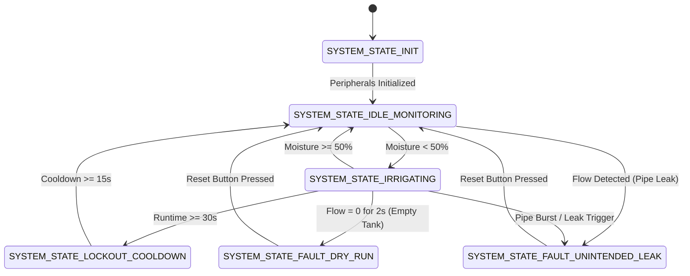

# Smart Irrigation & Water-Leak Controller
### 23CSE304 - Embedded Systems Project | Department of Computer Science & Engineering
**Target MCU**: STM32F103C8T6 (ARM Cortex-M3 @ 72 MHz, "Blue Pill")  
**Framework**: STM32 HAL Drivers / PlatformIO / Wokwi Simulator  
**Alignment**: UN SDG 12 (Responsible Consumption & Production)

---

## 👥 Student Team

| Name | Roll Number | Role |
| :--- | :--- | :--- |
| **K Dharani Kumar** | AM.SC.U4CSE24123 | Embedded Firmware & FSM Architecture |
| **K Bhanu Sai Raj** | AM.SC.U4CSE24125 | ADC Sensing & PWM Motor Control |
| **M Surya Kiran** | AM.SC.U4CSE24130 | Safety Timers, ISRs & Lockout Cooldown |
| **Ayman Jasim M R** | AM.SC.U4CSE24163 | Leak Diagnostics, SPI Telemetry & LCD Driver |

---

## 📌 Problem Statement
Agricultural water mismanagement, inefficient irrigation schedules, and undetected pipeline leaks cause massive freshwater wastage, soil over-saturation, and DC motor burnout. Conventional automated irrigation systems rely on crude continuous polling or fixed open-loop timers. 

This project implements an **event-driven, closed-loop resource-optimization system** on an ARM Cortex-M3 microcontroller that provides dynamic, demand-based watering while maintaining real-time pipeline integrity diagnostics.

---

## ⚙️ Key System Features

1. **Non-Blocking Finite State Machine (FSM)**: Event-driven architecture with zero blocking delays in the main loop.
2. **Periodic ADC Sampling**: 12-bit analog soil moisture acquisition (PA0) sampled periodically via hardware timer intervals.
3. **Proportional PWM Flow Control**: Dynamically adjusts DC pump speed (TIM2_CH2, PA1) based on real-time moisture deficit:
   - 0% Moisture $\rightarrow$ 100% PWM (Maximum flow)
   - 35% Moisture $\rightarrow$ 54% PWM (Gentle flow)
   - $\ge 50\%$ Moisture $\rightarrow$ 0% PWM (Pump stops)
4. **Over-Watering Lockout Cooldown**: Enforces a strict 30-second continuous irrigation safety ceiling followed by a 15-second lockout cooldown to prevent root rot and motor overheating.
5. **Real-Time Pipe Leak Detection**: Detects unintended water flow when the pump is OFF (due to cracked pipes or ruptured valves) and instantly triggers an acoustic and visual alarm.
6. **Dry-Run Motor Protection**: Monitors water flow when the pump is running; if no water flow is detected for $\ge 2$ seconds (empty tank / suction blockage), the MCU immediately shuts off the motor to prevent burnout.
7. **SPI Telemetry Logging**: Transmits packed 8-byte diagnostic telemetry frames over SPI1 to an external datalogger / EEPROM.
8. **16x2 HD44780 LCD Dashboard**: Real-time display of moisture percentage, pump status, PWM duty cycle, and fault diagnostic banners.

---

## 🔌 Hardware Pin Mapping

| Peripheral | STM32 Pin | Signal / Function | Connected Device |
| :--- | :--- | :--- | :--- |
| **ADC1_IN0** | `PA0` | Analog Input | Soil Moisture Sensor (Potentiometer) |
| **TIM2_CH2** | `PA1` | PWM Output (1 kHz) | L298N Motor Driver / DC Water Pump |
| **GPIO EXTI2** | `PA2` | Active-HIGH Input | YF-S201 Water Flow Sensor / Pulse Pushbutton |
| **GPIO EXTI3** | `PA3` | Active-HIGH Input | System Reset Pushbutton |
| **SPI1_NSS** | `PA4` | GPIO Output | SPI Chip Select |
| **SPI1_SCK** | `PA5` | SPI Clock | SPI Telemetry Bus |
| **SPI1_MISO**| `PA6` | SPI Master In | SPI Telemetry Bus |
| **SPI1_MOSI**| `PA7` | SPI Master Out | SPI Telemetry Bus |
| **GPIO Output**| `PB0` | LCD Register Select (RS)| 16x2 LCD Display |
| **GPIO Output**| `PB1` | LCD Enable (E) | 16x2 LCD Display |
| **GPIO Output**| `PB12` | LCD Data 4 (D4) | 16x2 LCD Display |
| **GPIO Output**| `PB13` | LCD Data 5 (D5) | 16x2 LCD Display |
| **GPIO Output**| `PB14` | LCD Data 6 (D6) | 16x2 LCD Display |
| **GPIO Output**| `PB15` | LCD Data 7 (D7) | 16x2 LCD Display |
| **GPIO Output**| `PB5` | Status Indicator | 🟢 Normal OK Green LED |
| **GPIO Output**| `PB6` | Status Indicator | 🟡 Irrigating Yellow LED |
| **GPIO Output**| `PB7` | Status Indicator | 🔴 Leak Alarm Red LED |
| **GPIO Output**| `PB8` | Acoustic Indicator | 🔊 Alarm Buzzer |

---

## 🔄 Finite State Machine (FSM) States



---

## 🧪 Operating Test Scenarios

### Scenario 1: Normal Idle Monitoring (Soil Hydrated)
* **Action**: Set potentiometer dial $> 50\%$ (e.g., 65%).
* **Output**: Pump OFF (`Pmp:OFF`, `PWM: 0%`), 🟢 **Green LED ON**.

### Scenario 2: Demand-Based Variable Irrigation
* **Action**: Turn potentiometer dial $< 50\%$ (e.g., 20%).
* **Output**: 🟡 **Yellow LED ON**, Pump starts with proportional PWM (e.g., 75%).

### Scenario 3: Over-Watering Prevention & Cooldown
* **Action**: Keep pump running continuously for 30 seconds.
* **Output**: Pump forcefully stopped, 🟡 **Yellow LED blinks**, LCD shows `PUMP COOLDOWN` for 15s.

### Scenario 4: Pipe Leak Alert
* **Action**: Click the **Blue Button** once.
* **Output**: 🔴 **Red LED ON**, 🔊 **Buzzer ON**, Pump shut down, LCD displays:
  ```text
  ALARM: PIPE LEAK
  UNINTENDED FLOW!
  ```

### Scenario 5: Dry-Run Pump Protection
* **Action**: Start irrigation (Moisture $< 50\%$) and wait 2 seconds without water flow.
* **Output**: 🔴 **Red LED ON**, 🔊 **Buzzer ON**, Pump cut off, LCD displays:
  ```text
  ALARM: DRY RUN! 
  PUMP NO WATER   
  ```

### Resetting Alarms
* Click the **Red Button** once to clear any alarm and return the system to 🟢 **Normal OK**.

---

## 🛠️ How to Build and Simulate

### Prerequisites
* [VS Code](https://code.visualstudio.com/)
* [PlatformIO IDE Extension](https://platformio.org/)
* [Wokwi Simulator Extension](https://wokwi.com/vscode)

### Build Firmware
```bash
pio run
```

### Run Simulation in VS Code
1. Open the project folder in VS Code.
2. Open `diagram.json`.
3. Press **`F1`** $\rightarrow$ select `Wokwi: Start Simulator`.
